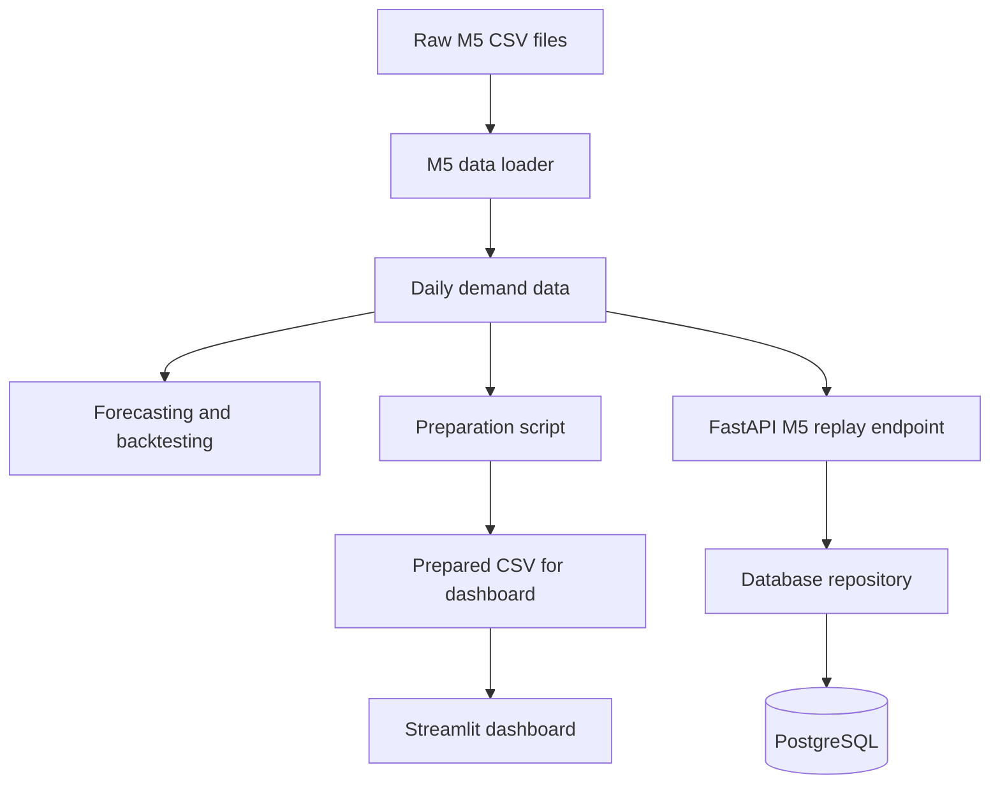

# DecisionOS — Project Guide for Developers

This guide explains the project in plain English: what it does, how the current code is organized, what works today, and what is still planned.

## 1. The project in one sentence

DecisionOS is a retail demand-forecasting project: it takes historical sales, prepares a consistent daily-demand dataset, evaluates forecasts, and is being developed toward inventory decision support.

**Important:** demand forecasting is not the same as inventory optimization. M5 gives historical sales, but it does not provide a retailer's current stock, purchase orders, supplier lead times, or replenishment costs.

## 2. Understand the project with one flow



The diagram describes the current paths. The dashboard currently reads a prepared CSV directly. It is **not yet connected end to end** to FastAPI and PostgreSQL for forecast results.

## 3. The most important files

| File or folder | In plain English |
|---|---|
| `backend/app/main.py` | Starts the FastAPI web application and registers routes. |
| `backend/app/api/v1/routes/ingestion.py` | Receives ingestion HTTP requests and coordinates loading, saving, and run status. |
| `backend/app/data/m5.py` | Reads M5 sales and calendar CSVs and converts them to standard daily-demand rows. |
| `backend/app/database/connection.py` | Sets up SQLAlchemy's database engine and session factory. |
| `backend/app/database/dependencies.py` | Gives an API request a database session and closes it afterward. |
| `backend/app/database/models.py` | Defines the database tables using Python classes. |
| `backend/app/database/repositories/demand.py` | Inserts or updates daily-demand rows in the database. |
| `backend/app/database/repositories/ingestion.py` | Creates, lists, and finishes ingestion-run records. |
| `backend/app/ml/baselines.py` | Runs simple forecasting baselines and walk-forward evaluation. |
| `backend/app/ml/forecasting.py` | Runs a feature-based machine-learning forecasting model. |
| `backend/app/schemas/ingestion.py` | Validates the shape of ingestion API requests and responses. |
| `backend/app/core/config.py` | Reads application configuration from environment settings. |
| `scripts/prepare_m5.py` | Prepares a CSV for analysis and the dashboard. |
| `scripts/backtest_demand.py` | Runs forecasting backtests on prepared daily-demand data. |
| `dashboard/streamlit_app.py` | Shows sales summaries and charts from prepared data. |
| `tests/` | Contains automated checks for selected behavior. |
| `alembic/` | Holds database schema migration scripts. |

There are also older modules under `backend/app/providers/` and `backend/app/services/`. The current M5 replay route no longer needs to go through those wrappers. Keep them until imports and tests have been checked before removing them.

## 4. The standard data format

The M5 loader converts the wide M5 sales table into four columns:

| Column | Meaning | Example |
|---|---|---|
| `date` | Date of the observation | `2011-01-29` |
| `product_id` | M5 item identifier | `HOBBIES_1_001` |
| `market` | Store identifier in this project | `CA_1` |
| `demand` | Units sold on that date | `3` |

Using one standard format makes the loader, forecasting functions, and database easier to work with.

## 5. Two workflows that exist today

### A. Prepare data and evaluate forecasts

1. Put the required raw M5 CSVs in `data/raw/m5/`.
2. Run `scripts/prepare_m5.py` to create a prepared daily-demand CSV.
3. Use `scripts/backtest_demand.py` to compare the baseline and ML forecasting approaches.
4. The Streamlit dashboard can read prepared data and display sales charts.

### B. Replay one item/store series into PostgreSQL

1. Start the FastAPI application.
2. Send `POST /api/v1/ingestion/m5/replay` with an `item_id` and `store_id`.
3. The route creates an ingestion-run record.
4. The M5 loader reads the selected series and converts it to standard rows.
5. The demand repository inserts or updates the rows in PostgreSQL.
6. The route marks the ingestion run completed or failed and returns its record.

The replay endpoint intentionally handles one item/store pair per request to keep memory use bounded. Replaying the same series uses the date/product/store key to update existing observations instead of adding duplicate logical records.

## 6. What the database tables mean

### `daily_demand`

Stores observed demand. A logical observation is uniquely identified by:

`date + product_id + market`

### `ingestion_runs`

Stores the history of data-loading attempts: source, mode, status, record counts, and start/completion timestamps. This helps investigate whether a data load completed or failed.

## 7. How forecasting works

- **Baseline models:** simple reference forecasts, including the last observed value and the value from the same weekday in the previous week.
- **ML model:** `HistGradientBoostingRegressor` uses lagged demand, rolling summaries, and calendar features.
- **Walk-forward backtesting:** each forecast uses only history available before its forecast window. This is meant to reduce future-data leakage.
- **Metrics:** MAE and RMSE measure errors in demand units; WAPE measures total absolute error as a percentage of total actual demand when that denominator is nonzero.

Always compare models on the same product/store, forecast horizon, dates, and missing-date policy. A single series is not proof that a model generalizes to all products and stores.

## 8. Current vs. future

### Present in the repository

- M5 and legacy Online Retail data-loading code.
- Data-preparation and backtesting scripts.
- Baseline and ML forecasting modules.
- FastAPI ingestion endpoints.
- PostgreSQL persistence models and repositories.
- Streamlit dashboard code.
- Automated tests and database migrations.

### Needs verification on a local machine

- M5 replay against the real raw files and the configured PostgreSQL database.
- Real-data forecast metrics and review of the resulting plots/output.
- A complete integrated run across data preparation, API/database, and dashboard.
- Current dashboard behavior after local changes.

### Planned, not yet a completed end-to-end feature

- Forecast-serving API and saved forecast results.
- Dashboard reading data and forecasts through the API/database.
- Inventory recommendations based on actual stock, lead times, orders, and clearly documented assumptions.
- Optional RAG/LLM explanations grounded in retrieved project data.

## 9. Local setup and commands (PowerShell)

Run these commands from the repository root with the intended virtual environment activated.

Install dependencies:

```powershell
pip install -r requirements.txt
```

Set the backend import path and run unit tests:

```powershell
$env:PYTHONPATH = "backend"
python -m pytest tests/unit -v
```

Prepare one item/store series (the IDs must exist in your downloaded files):

```powershell
python scripts/prepare_m5.py --item-id "HOBBIES_1_001" --store-id "CA_1"
```

Backtest the prepared data:

```powershell
python scripts/backtest_demand.py --input "data/processed/m5/daily_demand.csv" --product-id "HOBBIES_1_001" --market "CA_1" --output-dir "data/processed/m5/backtest"
```

Start the API after configuring the database URL and M5 directory and applying migrations:

```powershell
alembic upgrade head
uvicorn app.main:app --reload --app-dir backend
```

Open `/docs` on the local API server to inspect the available endpoints. The API/database workflow will only succeed when PostgreSQL is reachable and the required M5 files exist at the configured location.

## 10. A simple interview explanation

> “DecisionOS is a retail demand forecasting project. I use the M5 dataset as the first data source. The loader converts the raw sales table into a standard daily-demand format. I evaluate simple baselines and a feature-based machine-learning model using walk-forward backtesting. I also have a FastAPI ingestion endpoint that stores selected demand observations in PostgreSQL and tracks each ingestion run. The current dashboard reads prepared CSV data; connecting forecast results through the API and database, and adding inventory planning, are future steps.”

Only describe a workflow as verified after you have run it locally and checked the results. Passing unit tests alone does not verify the full real-data pipeline.
