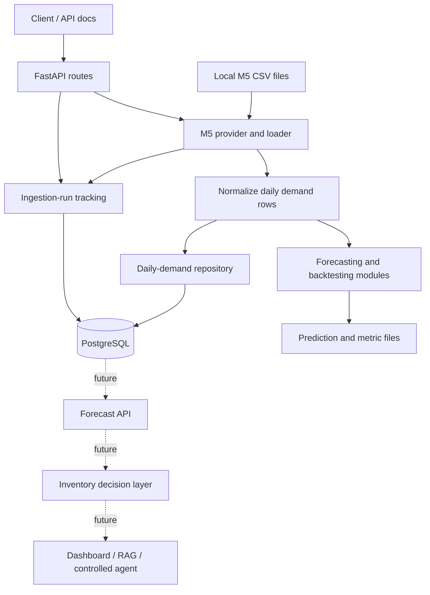

# DecisionOS — System Architecture

**Version:** 1.0  
**Purpose:** Make the system easy to understand, build, debug, and explain in interviews.

## 1. The idea in one sentence

DecisionOS is a retail demand forecasting and decision-support platform: it prepares historical sales data, stores daily demand, evaluates forecasts, and will eventually use forecasts plus real inventory inputs to support replenishment decisions.

## 2. Implemented versus planned

### Implemented in the repository

- M5 and Online Retail data loaders/scripts exist; **M5 is canonical for V1**.
- M5 loader converts the wide sales table plus calendar mapping into `date, product_id, market, demand`.
- Baseline and feature-based ML walk-forward evaluation code exists.
- FastAPI application and ingestion-run endpoints exist.
- SQLAlchemy models and Alembic migrations exist for ingestion runs and daily demand.
- M5 replay endpoint exists: `POST /api/v1/ingestion/m5/replay`.
- Unit tests run in GitHub Actions.

**Verification boundary:** CI passing confirms automated tests pass. The M5 replay path still needs a successful local run using the actual M5 CSV files and local PostgreSQL. Do not describe the full pipeline as end-to-end verified until that succeeds.

### Planned—not yet a complete implemented feature

- Full reusable ingestion orchestration and robust validation/rejection accounting.
- Forecast-serving API and persisted forecast records.
- Inventory-aware replenishment recommendations.
- Dashboard.
- MLflow tracking/registry.
- RAG assistant, LLM explanations, and controlled LangGraph agent.
- Production deployment and monitoring.

Build only what the next milestone needs; do not add frameworks just to make the architecture look more advanced.

## 3. Simple architecture diagram

Solid lines represent the main components currently present. Dashed lines are future work, not completed features.

## 4. End-to-end flow in plain English

1. **Source:** M5 contains historical sales by item/store in a wide CSV, plus a calendar file.
2. **Provider/loader:** the M5 code selects one item/store series and maps M5 day IDs to dates.
3. **Standard schema:** rows become `date, product_id, market, demand`. Forecasting code no longer needs to know M5's original column layout.
4. **Persistence:** the repository writes observations to `daily_demand`. The date/product/market unique key is intended to prevent duplicate rows when a series is replayed again.
5. **Run tracking:** `ingestion_runs` records provider, mode, status, record counts, and timestamps.
6. **Forecast evaluation:** separate scripts compare baseline and ML forecasts using time-aware walk-forward evaluation.
7. **API:** FastAPI exposes ingestion operations and returns structured responses. Routes coordinate work; they should not contain the ML algorithms or raw SQL.
8. **Future decision support:** once forecasts and real operational inventory inputs exist, a decision layer can suggest replenishment. An LLM should explain supported results, not invent numerical forecasts.

## 5. What each layer does

| Layer | Responsibility | Main code |
|---|---|---|
| API | HTTP requests, response shapes, status codes | `backend/app/api/v1/routes/` |
| Configuration | Database URL and M5 directory settings | `backend/app/core/config.py` |
| Provider/data loading | Read source files and normalize data | `backend/app/providers/m5_replay.py`, `backend/app/data/m5.py` |
| Schemas | Validate request/response shapes | `backend/app/schemas/` |
| Database | Engine, sessions, ORM models, migrations | `backend/app/database/`, `alembic/` |
| Repository | Database read/write operations | `backend/app/database/repositories/` |
| Forecasting | Baseline and ML backtests | `backend/app/ml/`, `scripts/backtest_demand.py` |
| Tests | Check expected behaviour | `tests/unit/`, `tests/integration/` |
| Documentation | Architecture, setup, decisions, evaluation | `docs/`, `README.md` |

**Remember:** route = HTTP; provider = source; schema = data shape; repository = database; ML module = forecast logic; test = evidence.

## 6. Read these files in this order

1. `backend/app/main.py` — creates the FastAPI app and registers routes.
2. `backend/app/api/v1/routes/ingestion.py` — ingestion endpoints, including M5 replay.
3. `backend/app/providers/m5_replay.py` — adapts local M5 files to the provider contract.
4. `backend/app/data/m5.py` — parses sales/calendar files into daily demand rows.
5. `backend/app/database/models.py` — `IngestionRun` and `DailyDemand` tables.
6. `backend/app/database/repositories/demand.py` — persists demand rows.
7. `backend/app/database/repositories/ingestion.py` — tracks ingestion runs.
8. `backend/app/ml/baselines.py` and `backend/app/ml/forecasting.py` — forecast evaluation.
9. `scripts/prepare_m5.py` and `scripts/backtest_demand.py` — local preparation/evaluation commands.

## 7. Two important database tables

### `daily_demand`

One row represents one product in one market/store on one date.

- `date`: observation date
- `product_id`: item identifier
- `market`: store identifier in the current M5 mapping
- `demand`: observed sales quantity

The unique key `(date, product_id, market)` represents one observation for that combination.

### `ingestion_runs`

One row represents one attempt to load data.

- `provider`, `mode`, `status`
- `records_received`, `records_inserted`, `records_rejected`
- `started_at`, `completed_at`

This provides operational visibility. Counts and failure behaviour still need local integration testing.

## 8. Why these choices?

- **Canonical schema:** makes data source formats interchangeable for downstream code.
- **Provider abstraction:** keeps source-specific parsing away from API and ML logic.
- **PostgreSQL:** durable structured storage for demand and ingestion metadata.
- **SQLAlchemy + Alembic:** Python database mapping plus versioned schema changes.
- **FastAPI:** request validation and documented endpoints.
- **Walk-forward evaluation:** uses earlier data to predict later periods and reduces future-data leakage.
- **Unit-test CI:** catches regressions on code changes.
- **One item/store per replay:** bounds memory while the full-dataset ingestion strategy is still being developed.

## 9. Limitations and next steps

1. Place M5 `sales_train_validation.csv` and `calendar.csv` locally; raw data is intentionally not in Git.
2. Apply migrations and verify the replay endpoint against local PostgreSQL.
3. Add endpoint-level tests for success, missing files, unknown item/store, database failure, and repeat replay.
4. Review record-count semantics and failure handling.
5. Run and document actual M5 forecasting metrics.
6. Add forecast-serving API and persistence.
7. Add explicit inventory inputs before replenishment logic.
8. Build dashboard, then consider RAG/agent features.

For an interview-ready explanation, see [DecisionOS Interview Guide](INTERVIEW_GUIDE.md).
