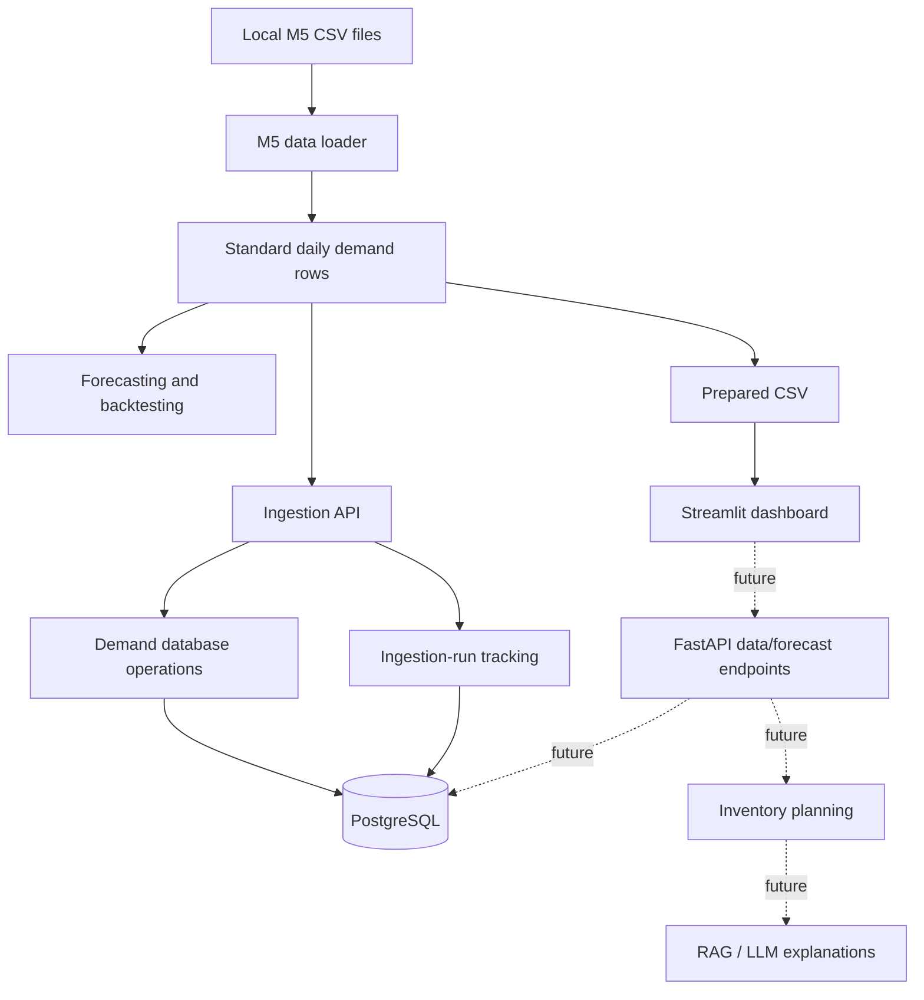

# DecisionOS — Simple System Architecture

## 1. What the project does

DecisionOS prepares retail sales data, evaluates demand forecasts, stores selected demand observations, and will later support inventory planning. M5 is the canonical dataset for V1.

## 2. Architecture in one picture



The diagram shows the current components and planned connections. The dashboard currently reads a prepared CSV directly. It is not yet wired to the API or PostgreSQL.

## 3. Folder responsibilities

| Location | Responsibility |
|---|---|
| `dashboard/streamlit_app.py` | UI, product/store/date filters, KPI cards and sales chart |
| `backend/app/main.py` | Creates FastAPI and registers routes |
| `backend/app/api/v1/routes/ingestion.py` | HTTP endpoints for ingestion-run records and M5 replay |
| `backend/app/data/m5.py` | Reads M5 sales/calendar files and returns standard daily-demand rows |
| `backend/app/data/online_retail.py` | Loader for the legacy Online Retail dataset workflow |
| `backend/app/ml/baselines.py` | Last-value and weekly seasonal-naive forecasts, walk-forward evaluation and metrics |
| `backend/app/ml/forecasting.py` | Feature-based HistGradientBoosting model and walk-forward evaluation |
| `backend/app/database/connection.py` | SQLAlchemy engine and session factory |
| `backend/app/database/models.py` | ORM definitions for `daily_demand` and `ingestion_runs` |
| `backend/app/database/repositories/` | Small database operations |
| `backend/app/schemas/ingestion.py` | Validates ingestion request and response data |
| `backend/app/core/config.py` | Environment-based application settings |
| `scripts/` | Manually run data preparation and backtesting jobs |
| `tests/` | Unit and integration tests |
| `alembic/` | Versioned database schema migrations |
| `docs/` | Setup, architecture and interview explanations |

## 4. The main data flow

### A. Prepare data for the dashboard

1. Downloaded raw CSVs live under `data/raw/m5/`.
2. Run `scripts/prepare_m5.py`.
3. It calls `backend/app/data/m5.py`.
4. The loader maps M5 day IDs to calendar dates and reshapes sales to `date, product_id, market, demand`.
5. The script writes `data/processed/m5/daily_demand.csv`.
6. Streamlit reads that prepared CSV, filters the selected product/store/date range, computes KPIs, and draws a chart.

### B. Replay a series into PostgreSQL

1. A client sends `POST /api/v1/ingestion/m5/replay` with `item_id` and `store_id`.
2. The route in `backend/app/api/v1/routes/ingestion.py` creates a pending ingestion-run record.
3. The route calls the shared M5 loader in `backend/app/data/m5.py`.
4. The demand repository inserts or updates rows keyed by date, product and market.
5. The route marks the ingestion run completed or failed and returns its status.

The API route coordinates this short workflow directly. We removed the unused `providers/m5_replay.py` and `services/ingestion_service.py` wrappers because the current endpoint did not call them. Data loading remains in `app.data`, and database operations remain in repositories.

## 5. Database tables

### `daily_demand`

One row is one product/store's observed demand on one date:

- `date`
- `product_id`
- `market` (the M5 store ID in this project)
- `demand`

The unique constraint on `date, product_id, market` means replaying the same series updates existing observations instead of creating duplicates.

### `ingestion_runs`

Tracks each ingestion attempt:

- provider, mode and status
- records received, inserted/updated and rejected
- start and completion timestamps

## 6. Forecasting flow

Forecasting is deliberately separate from HTTP routes and the dashboard.

- `baselines.py` compares last-value and weekly seasonal-naive forecasts.
- `forecasting.py` trains a HistGradientBoostingRegressor using lag, rolling and calendar features.
- `scripts/backtest_demand.py` runs both backtests on a prepared CSV.
- The models use walk-forward evaluation. Metrics should be compared on matching forecast origins and dates.

MAE and RMSE are errors in demand units. WAPE is percentage error relative to total actual demand; it is undefined if all actual demand in the evaluated window is zero.

## 7. What is implemented and what is planned

### Implemented in code

- M5 and Online Retail loaders and preparation scripts.
- Baseline and ML backtesting.
- FastAPI ingestion endpoints and ingestion-run tracking.
- SQLAlchemy models, demand persistence and Alembic migrations.
- Streamlit dashboard code locally created by the user.
- Unit-test workflow in GitHub Actions.

### Still needs local verification

- Full M5 replay against the user's PostgreSQL database and raw CSVs.
- Forecast metrics on a selected real M5 series.
- Full dashboard behavior after recent manual edits.
- A complete integrated run from data preparation through API/database to UI.

### Planned

- Forecast-serving API and stored forecast results.
- Dashboard reads via API/database rather than a local CSV.
- Inventory-aware planning after actual inventory/lead-time/order data is available.
- Optional RAG/LLM explanations grounded in the platform's data.

## 8. Why this architecture?

For the current MVP, a modular monolith is enough: one FastAPI application, a small number of clear modules, one database, and one dashboard. We keep boundaries that protect understanding and testing—data loading, forecasting, database operations, API validation—but avoid adding new service/provider layers unless they solve a real problem.

Future RAG/LLM code can live in a separate `ai/` module and call existing data/forecasting functions. The LLM should explain grounded results, not generate unsupported demand numbers or inventory facts.

## 9. Local commands

```powershell
$env:PYTHONPATH = "backend"
python -m pytest tests/unit -v
python scripts/prepare_m5.py --item-id "HOBBIES_1_001" --store-id "CA_1"
streamlit run dashboard/streamlit_app.py
```

For PostgreSQL ingestion, set `DATABASE_URL` and `M5_DATA_DIRECTORY` in your local environment, apply migrations with `alembic upgrade head`, run the API, and call the replay endpoint. Do not commit raw data or secrets.
